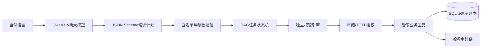

# 一、作品定位

明鉴 Agent 面向“用户说一句话即可办理业务，但始终看得见、停得住、查得到”的目标。队伍为 ALL IN队，学校为中央财经大学，成员石轩赫。版本 2.0.0 为可运行的本地真实大模型原型，账户与资金均为合成沙箱数据。

# 二、系统架构

浏览器提供对话与透明任务单双栏界面。server.mjs 只监听 127.0.0.1，并校验 Host、Origin、Cookie 会话和 CSRF。src/agent.mjs 调用本机 llama.cpp 的 OpenAI 兼容接口，使用严格 JSON Schema 约束模型输出。src/bank.mjs 在模型之外完成 DAG、参数、权限、版本、资金快照、幂等和原子性校验。模型无权直接修改数据库。

# 三、意图理解与任务规划

本地 Qwen3-1.7B Q8_0 根据当前需求及唯一待补充槽位生成 balance、bills、transfer、subscriptions、cancel_subscription 五种白名单动作。系统支持中文数词、模糊称谓、复合任务和跨轮补全。查询“余额后给室友两百元”会形成有序 DAG；“给妈妈转点钱”先询问金额，下一轮再绑定同一意图。

模型输出进入第二道确定性校验：未知工具拒绝，查询动作语义去重，收款人只能来自已登记联系人，金额转换为整数分并验证精度，依赖图必须无环。模型不可用、超时或格式不合格时系统停止规划，不悄悄伪造结果。

# 四、核心创新：授权差异检视

传统确认页通常只展示修改后的最终值。明鉴保存修改前后两个服务端快照，展示收款人、金额、权限等级、日累计和预计余额的差异，并计算后续节点受影响情况。任何参数修改都会递增计划版本，删除旧审阅凭证与挑战，使旧确认不可复用。执行前若其他交易改变余额或日累计，快照同样失效并要求重审。

# 五、权限与执行

| 级别 | 当前场景 | 执行条件 |
| --- | --- | --- |
| 绿色 | 余额、账单分析 | 意图确认后自动调用只读工具 |
| 黄色 | 日累计不超过1000元转账、订阅查询与取消 | 展示详情，获得明确确认 |
| 红色 | 日累计超过1000元转账 | 明确确认加手机TOTP动态码 |

交易在 SQLite 事务中重新计算权限和余额。每个节点只执行一次，重复点击返回同一状态，不重复扣款。成功结果只来自工具回执；账单分类来自合成明细聚合，异常提示引用对应记录。

# 六、安全机制

Prompt 注入不能改变服务端工具白名单和权限策略。可疑绕过指令直接拒绝；连续失败触发五分钟会话熔断。计划有效期十五分钟，审阅凭证和强验证挑战有效期两分钟。TOTP 遵循 RFC 6238，支持前后一个时间窗并禁止动态码重放。审计记录以前一条摘要连接形成哈希链，篡改后业务入口停止服务。

模型与引擎在本机 CPU 运行，不向云端发送对话；模型服务仅绑定 127.0.0.1，并由随机 API 密钥保护。应用不开放代码执行工具或任意网络工具。

# 七、数据与测试

初始模拟余额为25000元，包含12条合成消费和3个演示联系人。金额以整数分保存，日界线为 Asia/Shanghai。39项自动化测试覆盖分级边界、并发累计、幂等、回滚、快照失效、注入、会话隔离、审计篡改和TOTP；6项真实模型语义回归全部通过。

# 八、已知边界

本作品不连接真实银行，不具备生产身份登录、TLS公网部署、硬件密钥托管、短信/人脸/U盾及真实反洗钱系统。SQLite 与 TOTP 密钥未采用硬件加密。理财、卡片、定时转账和AA尚未实现。1.7B小模型可能误解超出测试集的表达，因此所有写操作必须经过独立校验和人工确认。
